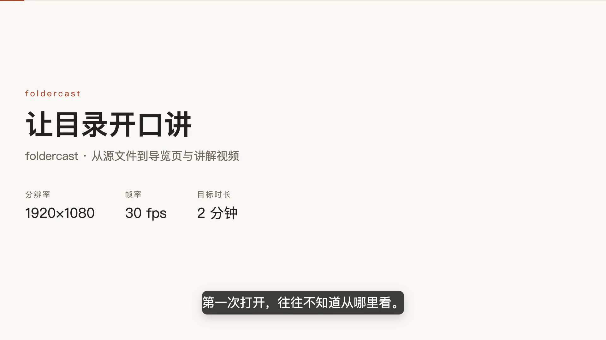
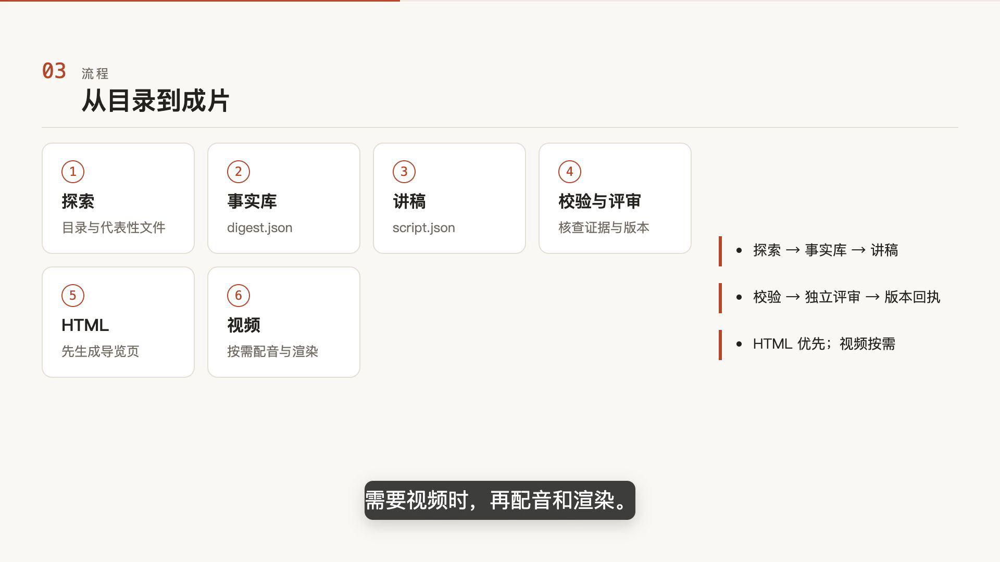
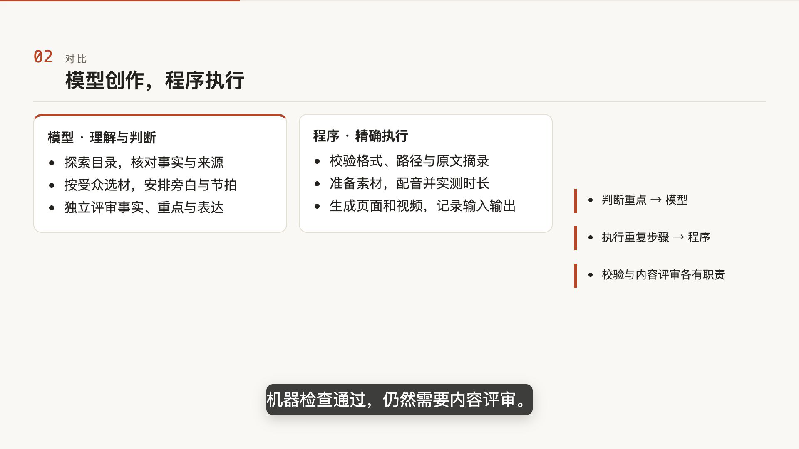

# foldercast · 目录放映

**把一个目录，讲成一段视频或一页导览。**

foldercast 是 DSH 插件。给它一个人类可读的目录，Agent 理解内容、挑选证据、写成讲稿并独立评审；插件把讲稿生成 HTML 导览页，或带旁白的视频。代码仓库、文档资料、图片与 Office / PDF 都可以成为讲述素材。

[安装与设置](docs/usage.md) · [开发与 CLI](docs/development.md) · [设计决策](docs/decisions/0008-trusted-execution.md) · [变更记录](CHANGELOG.md)

## 看看实际效果

下面的示例由 foldercast 解析自己的仓库生成，使用瑞士风格。截图来自实际渲染，HTML 和视频共用一份讲稿。

[](docs/showcase/foldercast.mp4)

**[观看／下载 MP4](docs/showcase/foldercast.mp4)** · **[下载 HTML 导览页](docs/showcase/foldercast.html)** · [讲稿与生成说明](docs/showcase/README.md)

GitHub 文件页不会直接运行 HTML；下载后在浏览器打开即可阅读。本例不引用外部图片，可单文件保存和转发。

| 工作流：从理解到产出 | 职责：创作与执行 |
|---|---|
|  |  |

## 从哪里开始

需要 DSH 和 Node `^22.19.0 || >=24.0.0`。在 DSH 使用的 profile 中安装 0.3.1：

```bash
dsh plugin --profile <profile> add dsh-foldercast@0.3.1
```

安装后重启 DSH，在对话中说明目录和讲述目标，例如：

> 把这个仓库讲给第一次接触它的开发者，重点解释用途和工作流。先生成 HTML 导览页，再生成带旁白的视频。

也可以只要页面：

> 把这个资料目录整理成 HTML 导览页，突出核心观点和代表性文件。

设置页可选择受众、重点、深度、目标分钟数、美术风格、配音引擎和音色。默认按需询问；已有上下文和当前要求优先。完整设置、MiMo 密钥和 Release 安装方式见[插件使用说明](docs/usage.md)。

## 它怎样讲清一个目录

1. **理解内容**：Agent 查看目录和代表性文件，先写知识压缩 `digest.json`，保留来源与原文摘录。
2. **组织讲述**：根据受众和目标写 `script.json`，选择流程、对比、观点、文件摘录等场景，安排旁白与节拍。
3. **校验与评审**：程序检查格式、引用和版本；独立 Agent 核查事实、数字、重点、遗漏、结构与表达。
4. **生成产物**：评审通过后先生成 HTML；明确需要视频时，再配音、渲染 MP4。

**模型负责理解、判断与创作；程序负责精确、重复、可复现和可验证的执行。** 机器校验和版本回执不能替代内容评审。[设计依据](docs/decisions/0008-trusted-execution.md)

## 输出与风格

| 输出 | 用途 |
|---|---|
| HTML 导览页 | 按区块阅读旁白、要点与来源；可以只生成页面 |
| MP4 视频 | 节拍随字幕出现；有配音时采用实测音频时长 |
| digest 与讲稿 | 保留事实库和创作输入，可修改后重新校验、评审与生成 |

产物默认位于源目录的 `.foldercast/`。HTML 与视频共用场景内容和素材准备。支持瑞士风格、编辑设计风格、科技风格，也可用自定义描述指导选材和叙事；实际画面仍使用现有场景模板。设置变化不会自动改写讲稿或重做产物。

## 使用前需要了解

- **内容会进入模型上下文**。写稿流程要求避开 `.env`、`*.pem`、`credentials*` 等文件；使用前确认目录适合交给模型读取。
- **依赖按输出需要**：视频需要 Chrome / Chromium / Edge；配音需要网络及 `ffmpeg` / `ffprobe`。Edge 默认免密钥，MiMo 需要 `MIMO_API_KEY`。缺少某步依赖会影响该步。[环境与 CLI](docs/development.md)
- **HTML 转发**：图片超过内联预算时会保留相对路径，需一并转发素材；Office / PDF 页图和视频封面也需保留对应位置。
- **许可**：foldercast 自有代码使用 [MIT](LICENSE)；Remotion、LibreOffice 与 FFmpeg 等第三方组件保留各自许可。[许可说明](docs/licensing.md)

源码、示例与文档位于本仓库；问题和建议请提交到 [GitHub Issues](https://github.com/Luan-Fuzi/foldercast/issues)。
